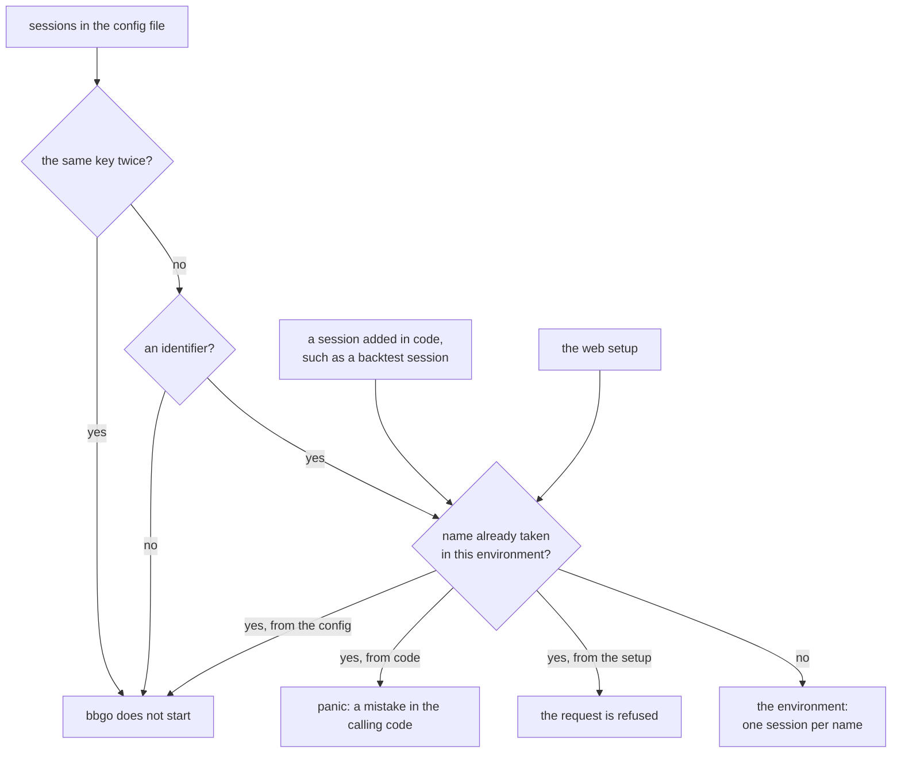

# ADR: Identifiers

- Status: Accepted. The session name is the first identifier covered,
  and is implemented. The other identifiers bbgo uses are listed under
  "Not covered yet" and get their own section here as each is
  designed.
- Scope: `pkg/types` (`ValidateIdentifier`), `pkg/bbgo` (the
  environment and its sessions), `pkg/cmd` (the backtest start-up)

## Goal

Every value that names something in bbgo has a stated form, a stated
scope in which it is unique, and one place where bbgo checks it.

## Context

A name in bbgo does not stay inside the process. A session name is a
key in database rows, a label on metrics and a field in logs. So are
exchange names, instruments and assets. Once a name is stored, its
exact spelling is part of the data: change it, or let two things share
it, and the rows no longer mean what they say.

bbgo had no rule for any of them. For the session name, which is the
one a user types freely:

- Any string was accepted, including uppercase, spaces and names
  longer than the column they are stored in.
- `Binance` and `binance` were two sessions to the config parser and
  one to a case-insensitive database collation.
- Adding a session in code under a name that was taken replaced the
  first one silently.
- The CSV backtest relied on that: it created the live sessions of
  the config and then overwrote each with a simulated one.

The margin interest history made this matter, by storing rows per
session (`doc/design/margin-interest-budget.md`).

## Decision

### Principles

1. **An identifier has a form, a scope and a check.** The form says
   which strings are allowed. The scope says within what it is unique.
   The check says where bbgo enforces both. A name with only a form is
   not an identifier yet.
2. **It is checked where it enters.** A bad value stops bbgo at
   startup, when the config is loaded, before anything has been stored
   under it. Not later, in whichever service first writes it.
3. **One validator.** Identifiers that bbgo lets the user choose share
   one form and one function. There is no identifier type yet; the
   function comes first and the type can follow.
4. **No exception in the code.** If a rule needs an exception, its
   scope is stated wrongly. Fix the scope, not the rule.

### The form

`[a-z0-9_]`, 1 to 64 characters.

- **Lowercase only,** so two identifiers cannot differ by case alone.
- **No spaces, separators or other special characters,** so an
  identifier never needs quoting or escaping in a query, a path or a
  metric label.
- **A bounded length,** so it fits the column it is stored in.

A violation names the character and its position, and every bad name
of a config is reported at once.

### The session name

**Scope: within one running bbgo, a session name refers to exactly one
session.** It is not unique beyond that, and it is one of three layers
that together say where a stored row belongs:

| Layer | Separates | How |
|---|---|---|
| Database | one deployment from another, and backtests from live | assumed: a database belongs to one deployment |
| Run | one backtest run from another | a run id, which the backtest generates |
| Session name | the sessions within one run | checked, see below |

- **A backtest session takes the name of the live session it stands in
  for.** A strategy that says `on: binance` has to find the simulated
  session under that name. This is not an exception to the scope: a
  backtest is another run, and it has one `binance` like any other.
  The backtest therefore does not create the live sessions at all.
- **The session name cannot tell backtest data from live data,** and
  is not meant to. If backtest results are stored, the database or the
  run id separates them. Many runs use the same session name.
- **Renaming a session is a change of identity.** What is stored under
  the old name is no longer found.

Where it is checked:

- **The form is checked on the names of the config,** which are the
  ones a user chooses. A session added in code is named by the code,
  usually after its exchange, and every exchange name is an
  identifier.
- **A taken name is refused on every path.** Loading a config returns
  an error. Adding a session in code panics, because two sessions
  under one name is a mistake in the calling code and replacing the
  first one would hide it.

What bbgo assumes and does not check:

- **A database belongs to one deployment.** Two deployments that share
  a database and both have a session `binance` would mix their rows
  under one key. Nothing inside one process can see that.
- **A session is one account.** bbgo has no account identity. Two
  sessions on the same exchange account are two names for one thing,
  and whatever is stored per session is stored twice.

### Not covered yet

These also name things in bbgo and end up in stored data. Each gets a
section here, with its form, scope and check, when it is designed:

- **Exchange names.** bbgo owns them; they are a fixed list. A test
  already holds that each one is an identifier.
- **Instruments and assets.** Named by the exchange, not by the user
  or by bbgo.
- **Strategy ids and strategy instance ids.**
- **Chain session names.** Chosen by the user, like exchange session
  names, and not validated today.

## Alternatives considered

- **Refusing a taken name without changing the backtest.** Every CSV
  backtest would fail with "session binance is already defined", which
  tells the user the opposite of the truth: the backtest session must
  have the live name.
- **Keeping the replacement, as the backtest's exception.** A rule
  with an exception has to be explained to every user and guarded in
  every check. Stating the scope as one run removes the exception.
- **A different name for backtest sessions,** such as a prefix.
  Strategies refer to sessions by name, so the config would need a
  second mapping, and a prefix still cannot tell two runs apart.
- **Returning an error from `AddExchangeSession`.** The more usual Go
  shape, but it changes the signature of a method strategies and
  tools call, for a case that is a programming mistake. The paths that
  take user input return errors.
- **Allowing hyphens or uppercase.** Uppercase reopens the case
  problem. One separator is enough, and `_` is the one the example
  configs already use.
- **Validating in each service that stores the name.** That is where
  the first check landed (a length check before the margin sync). It
  runs after other things already used the name, and each service
  would have its own rule.
- **An identifier type now.** It would touch every place a session
  name is passed as a string. The function gives the check today.
- **An account id as the identity of a session.** Considered with the
  margin interest history and not taken; see
  `doc/design/margin-interest-budget.md`.

## Consequences

- Positive: a session name means the same thing in the config, the
  database, the metrics and the logs, and cannot collide by case.
- Positive: the code has no path that replaces a session, so nothing
  has to know about an exception.
- Positive: the CSV backtest no longer builds live exchange clients,
  with their credentials, that it never uses.
- Negative: a config with a session name outside the form, such as
  one with a hyphen or an uppercase letter, no longer starts. The
  session has to be renamed, and what was stored under the old name is
  not carried over.
- Negative: code that adds two sessions under one name now panics
  where it used to keep the second.
- Negative: in a CSV backtest, a strategy on a session that is not one
  of the backtest sessions now fails as an undefined session.
- Accepted limits: one database per deployment and one session per
  account are the user's to keep.

## References

- `pkg/types/identifier.go` — `ValidateIdentifier`.
- `pkg/bbgo/environment.go` — the checks when sessions are loaded and
  added.
- `pkg/cmd/backtest.go` — the backtest start-up, which marks the run
  as a backtest before the sessions are configured.
- `doc/design/margin-interest-budget.md` — the first data stored per
  session.
