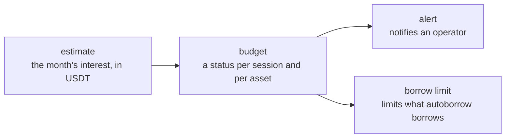
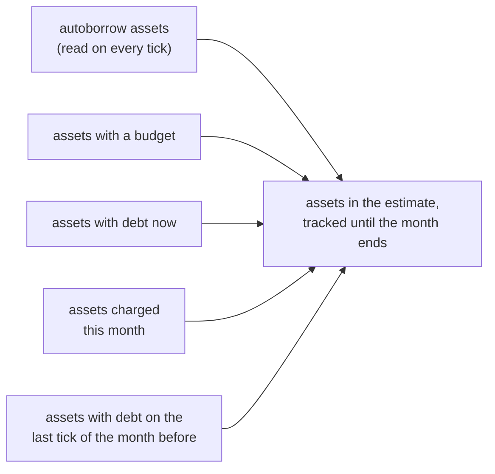
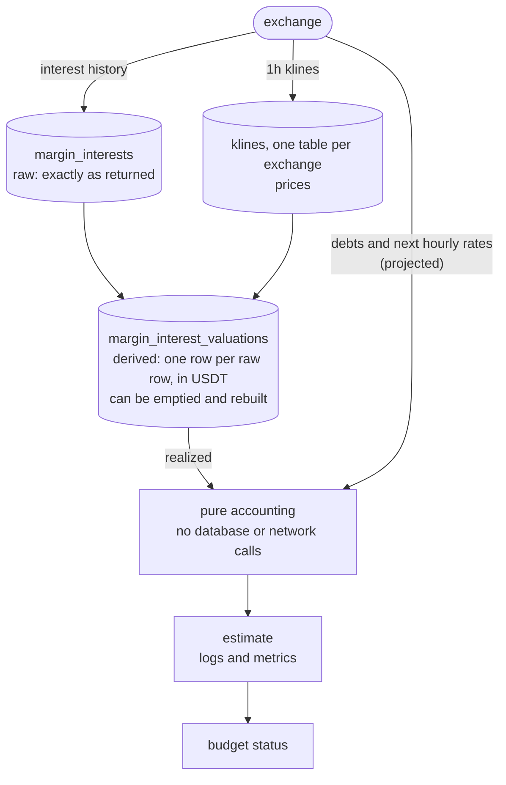
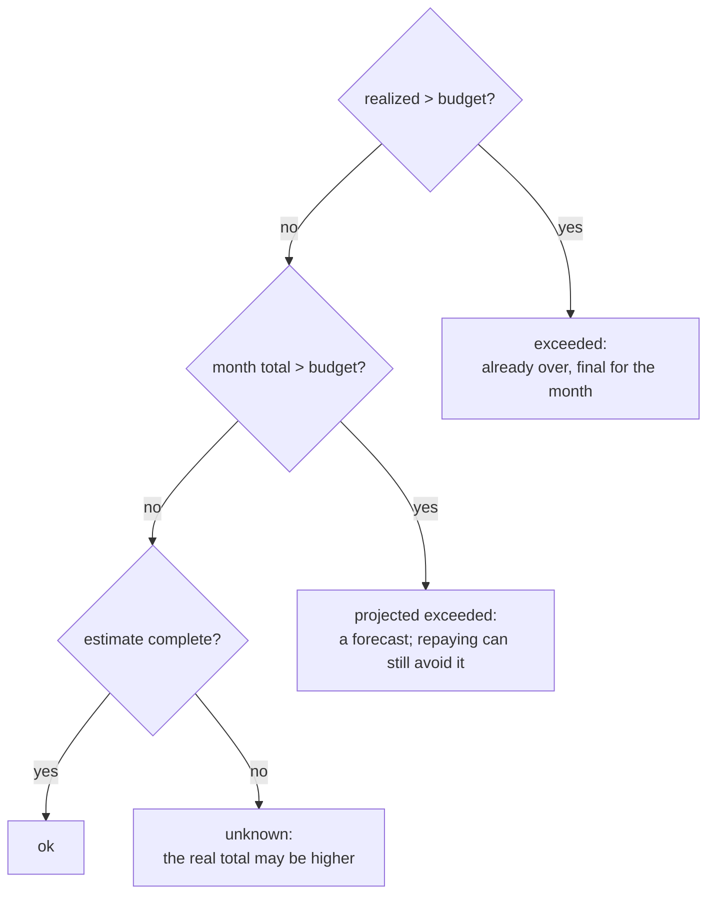
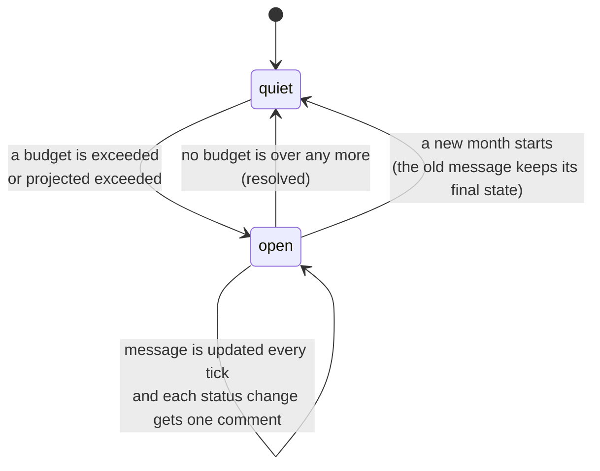
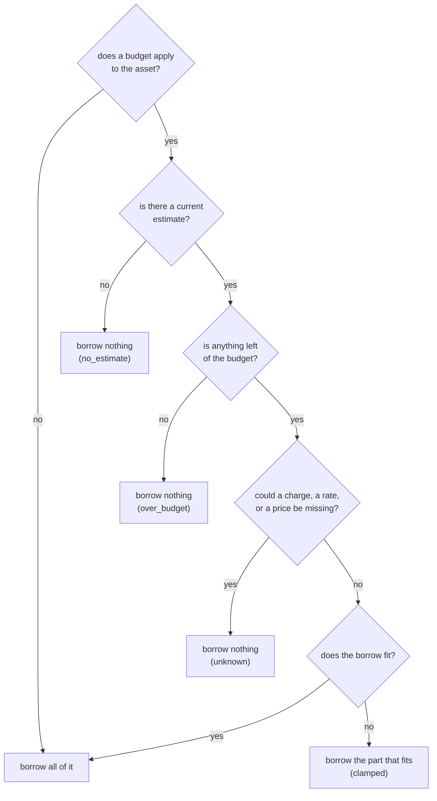

# Architecture Decision Record: Margin Interest Budget

- Status: Accepted
- Affected areas: `pkg/strategy/autoborrow`, `pkg/accounting/margininterest`, `pkg/service`, `pkg/bbgo` (session names), and two database tables (`margin_interests` and `margin_interest_valuations`).

## Goal

For each margin session, we want to know how much interest the session will pay in total by the end of the month, measured in USDT. We also want to keep that total under a budget. To do that, `bbgo` needs to report the total, send an alert when the total goes over the budget, and stop the `autoborrow` strategy from borrowing past the budget.

## Context

Before this design, nothing in `bbgo` could answer how much interest a session would pay in a month:

- An account balance only includes interest that is still unpaid. It does not include interest that has already been settled.
- The alert for high interest rates in `autoborrow` calculates a total for the next hour, but it only counts assets whose rate is above its threshold.
- The sync for the history of margin interest only ran once at startup. It saved rows per exchange without a session name, and it had no method to read them back. Because of that, two sessions on different accounts shared the same rows. The second session resumed from the first session's newest row and silently skipped its own history.
- `bbgo run` never saved candlestick (kline) data. As a result, a live database had no historical prices to calculate the USDT value of a past charge.

Two facts about how the exchange works shape this design:

- **Interest is simple and charged every hour.** At the top of each Coordinated Universal Time (UTC) hour, Binance charges the principal multiplied by the hourly rate. That charge covers the hour that is starting. When you borrow, Binance also makes one immediate charge for the time left in that hour. Unpaid interest does not earn more interest. The exchange API also returns an annualized rate, which is a compound Annual Percentage Yield (APY). That compound rate is the wrong number to use for a budget.
- **Debt cannot be tied to a single strategy.** The exchange reports one borrowed amount per asset for the whole account. The `autoborrow` strategy borrows explicitly, but any order with a margin setting that allows borrowing also borrows automatically. In addition, repayments do not specify which loan they pay back. Because of this, a budget can accurately cover a whole session or one asset in that session, but it can never cover a single strategy.

## Decision

### Four parts, and only one of them takes action

- **The estimate** calculates both the interest already paid and the interest projected for the rest of the month, and reports them.
- **The budget** sets a monthly limit for a session and for individual assets in that session, then compares the estimate against those limits.
- **The alert** notifies an operator when a budget is over its limit. The operator then repays debt or changes strategy settings by hand.
- **The borrow limit** keeps `autoborrow` from borrowing more than the budgets allow.

The estimate, the budget, and the alert only observe and report. The borrow limit is the only part that changes how `bbgo` borrows. It is turned off by default, because operators need to trust the numbers before letting those numbers block borrowing.

### Principles

1. **Hours are the base unit, and a month is just a range of hours.** The exchange charges by the hour. Because of that, the accounting code takes a number of hours or a range of hours, never a month.
2. **Raw data stays raw.** The raw table stores exactly what the exchange returned, using Binance's format. Data from other exchanges is mapped into that same format. Nothing in the raw table is converted to USDT, tied to a strategy, or modified.
3. **Derived data can be rebuilt at any time.** Anything calculated from raw rows and prices lives in its own table. You can empty that table and rebuild it from scratch whenever you need to, so you never need a migration to fill in old rows.
4. **The accounting code is pure.** It takes raw rows, interest rates, and a function that looks up prices as inputs. It never talks to a database or an exchange. That makes it easy to test with numbers calculated by hand.
5. **The estimate covers the whole session, not just a configured list.** Every interest charge on the session counts toward the total, no matter which asset it is for or what opened the debt. The assets configured in `autoborrow` are also included in the report, even when they have no debt.
6. **An incomplete total is a lower bound, and is marked as incomplete.** If a total is missing a rate, a price, or part of its history, `bbgo` still publishes it, along with a flag that marks it as incomplete. No part of the system may treat "incomplete and under budget" as "ok".
7. **USDT is the unit of account, and we always call it USDT.** We do not label it as "USD".

### What the user is responsible for

This design relies on two rules that `bbgo` cannot verify on its own:

- **Use one session per margin account.** In `bbgo`, a session is just a name, a set of credentials, and a margin setting. There is no separate account ID, and `bbgo` does not compare credentials across sessions. This design uses the session name as the account key, so you must give each margin account exactly one session. If two sessions point to the same margin account, both sessions will save the same charges and report the full bill. Adding them together would count the same interest twice.
- **On an account with a borrow limit, only `autoborrow` should borrow.** An order with a margin setting that allows borrowing will borrow on its own, and the borrow limit does not see that order before it is sent. Do not run strategies that place those orders on an account where budgets limit borrowing.

An order borrows automatically when its margin setting is `MARGIN_BUY` or `AUTO_BORROW_REPAY`. By contrast, `AUTO_REPAY` only repays debt. The built-in strategies below send borrowing orders on a margin session, so do not run them on an account with a borrow limit:

| Strategy | What borrows |
|---|---|
| `xmaker` | Hedge orders on its hedge session (both the direct hedge and the `market` hedge method) |
| `supertrend` | The order that opens a position |
| `linregmaker` | Its maker orders |
| `pivotshort` | Resistance short orders, break-low entries, and failed-break-high entries |
| `emacross`, `elliottwave`, `drift`, `example/rsicross` | The order that opens a position |
| `support` | Its orders, when `marginOrderSideEffect` is set to borrow |

The strategies that open a position call `OpenPosition` or `NewOrderFromOpenPosition` in `GeneralOrderExecutor`. Those functions always set `MARGIN_BUY`, so any other strategy that calls them belongs on this list too. The same is true for manual orders sent with `bbgo submit-order --margin-side-effect`. Strategies that send plain orders are fine, because plain orders only spend what the account already holds, including funds that `autoborrow` borrowed.

### The estimate

#### Realized plus projected, split at the current hour

The exchange makes each hourly charge at the top of the UTC hour, and that charge pays for the hour that is starting. Because of that, we split the month at the end of the current hour:

- **One split point divides both sides.** Every hour in the month is counted exactly once. The charge for the current hour has already happened, so it is always counted as realized interest, never projected interest.
- **The projection uses only the principal, not the total debt.** Unpaid interest does not earn more interest. Including unpaid interest in the projection would make the forecast too high for every remaining hour.
- **The projection assumes today's principal and rate stay the same.** It forecasts what the session will pay if nothing changes. The worker recalculates it from live values on every scheduled check (called a tick).
- **Two monthly views use the same hourly math.** The first view is the calendar month in UTC, which adds realized interest and projected interest together. Budgets use this view because a budget must include what you have already paid. The second view is a rolling month of 720 hours starting now, with no realized part. That gives you the monthly pace at today's rate, so you can compare it to a monthly number on any day of the month.

For example, at 10:20 UTC on November 15, 347 of the month's 720 hours have already been charged, and 373 charges remain. If you have a debt of 10,000 USDT at an hourly rate of 0.000005, the projected interest for the rest of the month is 18.65 USDT. Over a rolling 720-hour month, that same debt projects 36 USDT.

#### Which assets the estimate covers

The estimate covers every asset that the session pays interest on, not just the assets listed in the `autoborrow` config. Operators can edit that list between restarts, or change it while `bbgo` is running (using the Remote Procedure Call, or RPC, feature in `doc/design/core-rpc-export.md`). Debt can also be opened outside of `autoborrow`. If the estimate only tracked the `autoborrow` list, it would miss most of what a session could pay. Worse, removing an asset from the list would make its past charges disappear from the month's total.

- **Realized interest includes every charge on the session for the month.** There is no filter by asset. Once an asset is charged, that charge stays in the total. Changing a config list cannot make an exceeded budget look fine again.
- **Projected interest includes every debt the session holds right now.**
- **The worker reads the asset list in `autoborrow` on every tick.** It reads the list the same way the borrow loop does, so the estimate picks up changes made at runtime.
- **Once an asset enters the estimate, it stays there until the month ends.** Even if the asset is repaid or removed from the config list, `bbgo` keeps syncing it for the rest of the month. That way, its final hourly charges are still recorded, and a failed sync keeps the estimate marked as incomplete instead of being ignored.
- **A new month starts with the assets that had debt on the last tick of the previous month.** Those assets get charged at the first hour of the new month, even if they are repaid before the first tick of the new month runs. Every other asset has to enter the estimate again on its own.
- **Any asset new to the estimate is synced right away, and failed syncs are retried on the next tick.** If an asset enters through a current debt, a budget, or the `autoborrow` list, `bbgo` syncs it on the same tick it appears. If an asset is first discovered from existing database rows, `bbgo` counts it on that tick and syncs it on the next tick. Between full syncs, only these new or failed assets are synced. Until an asset finishes syncing, its history is treated as missing. If an asset drops out at the end of a month and comes back later, it is treated as new again.

#### Where the data lives

- **Raw rows are deduplicated using the exchange's own transaction ID.** One borrowed asset can have several charges in the same hour: one for each borrow, plus the regular hourly charge. Two of those charges can even have the same principal. Any unique key built from other columns would accidentally drop real charges.
- **Raw rows are stored per session.** Each session can then resume syncing from its own newest row, and the estimate can filter rows by session.
- **Old rows without a session name are not migrated.** They stay in the table and are never read. Instead, `bbgo` fetches the history again under the new session name. That is simpler and safer than guessing which session owned the old rows.
- **The USDT valuation lives in its own table, not as a column on the raw row.** If a price is not available yet, `bbgo` can still save the raw charge without failing. We can also change how valuations work later without running a database migration.
- **The estimate itself is not saved to the database.** The database stores only the realized inputs. Every tick recalculates the rest from scratch.

#### Valuing a charge in USDT

- **Price point:** `bbgo` uses the closing price of the 1-hour kline that ends when the charge's hour begins. That kline is already closed by the time the exchange publishes the charge. By contrast, the kline that contains the charge does not close until up to an hour later.
- **Trading pair:** `bbgo` looks up the asset directly against USDT, in either direction. It does not route through a third asset unless a future asset requires it. If an asset has no USDT pair, `bbgo` leaves it unpriced and marks the estimate as incomplete.
- **Both assets are valued:** `bbgo` values both the asset that was paid and the asset that was borrowed, using the same kline. These two assets only differ when interest was paid in a separate fee asset.
- **The valuation step downloads its own klines.** A live `bbgo` instance does not save klines for anything else, so the valuation pass syncs the 1-hour klines for the pairs it needs.
- **The valuation step runs on every tick**, right after a sync if a sync was due. When no raw rows are waiting to be valued, this check is just one fast query. If a kline was missing on one tick, `bbgo` retries it on the next tick instead of waiting for the next full sync interval. The valuation step also has its own timeout, so a slow sync cannot use up all the time and leave new rows unvalued. If the valuation step fails, the newly synced rows have no USDT value and are not read, so the estimate stays marked as incomplete until the valuation succeeds.
- **Two pricing modes for realized interest:** The default mode is "Charged", which values each charge at what it cost when it was paid. The other mode is "Current", which revalues past charges at today's price. Projected interest is always valued at the current price.
- **The estimate fetches the current prices it needs on every tick.** It fetches the price of every asset that currently has debt. When using the "Current" pricing mode, it fetches the price of every asset in the estimate, including the fee asset. Normally, a session only tracks prices for markets that a strategy subscribed to at startup, which misses assets nobody subscribed to. The fetched prices are also fed into the session's price solver, so other `autoborrow` alerts that value debt can use them too.
- **Missing prices are treated as stale and mark the estimate as incomplete.** If a price request fails, `bbgo` still calculates the numbers using the last price the session has. That is better than dropping the debt from the total altogether. However, `bbgo` flags the estimate as incomplete, so any budget that relies on that price shows as "unknown" instead of "ok". A ticker with no price and an asset with no USDT market both count as missing prices. All price requests in a tick share one timeout, so a single slow ticker cannot stall the tick.

#### Interest paid in another asset

When fee deduction in Binance Coin (BNB) is enabled, Binance charges interest in BNB at a discount compared to the nominal amount. Binance reports those charges only under BNB, never under the asset that was actually borrowed.

- **The fee asset is always synced**, even if it is not in your config. If syncing the fee asset fails, `bbgo` treats every asset's history as possibly incomplete.
- **Each charge counts toward the asset that was borrowed.** The report for that asset shows the nominal amount in that asset's own units, and keeps the actual amount paid in BNB right beside it.
- **The USDT value comes from what was actually paid**, so the fee discount is reflected in the USDT total.
- **A charge that cannot be matched to a borrowed asset is not counted**, and it marks the estimate as incomplete. Guessing which asset it belonged to would hide the problem.
- **Projected interest stays at the nominal rate.** On an account that pays fees in BNB, the projected portion of the month's total will be slightly high, by roughly the amount of the BNB discount. Erring on the high side is the safer direction for a budget.

#### Where the estimate runs

The estimate runs inside the `autoborrow` strategy, with one worker per session, because `autoborrow` is the only strategy that needs it. Only the pure accounting code is shared. This follows the layout in `doc/development/strategy-layer-design.md`.

Projected interest is live on every tick. Realized interest lags behind by the sync interval, and that normal lag does not make the estimate incomplete. The estimate is only marked incomplete when there is a missing rate, a missing price, a failed sync, an asset that has not synced yet, or a charge that cannot be matched to a borrowed asset.

#### Session names are identifiers

Because the session name is used as a database key, it must be a well-formed, stable identifier. You can find the exact rules for its format, uniqueness, and validation in `doc/design/identifiers.md`.

Renaming a session changes its identity. Rows saved under the old name are no longer read, and `bbgo` fetches the history again under the new name.

### The budget

A budget is a USDT limit for one calendar month in UTC. You can set a budget for the whole session (which sums every asset in the estimate) and separate budgets for individual assets. Budgets live inside the estimate's config because a budget makes no sense without an estimate. Configuring a budget while the estimate is turned off, or on a session where the estimate cannot run, causes a startup error instead of silently doing nothing.

- **Session budgets and asset budgets are independent.** Both are optional, and asset budgets do not need to add up to the session budget. The session budget answers "how much may this whole account cost?" while an asset budget answers "how much may this one asset cost?" Forcing them to match would just create another way to misconfigure them.
- **Asset budgets are also in USDT.** Using USDT lets you compare and add budgets together, and gives a single clear value even when interest is paid in another asset. Charges still count toward the asset that was borrowed.
- **A budgeted asset does not have to be in the `autoborrow` list.** The asset list can change while the budget stays in place, so this is allowed. `bbgo` logs it once, and logs it again if the list of such assets changes. However, the asset must exist on the exchange. A misspelled asset name would never have any debt or charges and would show "ok" forever, so `bbgo` refuses to start if a budgeted asset is unknown to the exchange.
- **Only one `autoborrow` instance may set a budget for a session.** If a second instance tries to set a budget on the same session, `bbgo` rejects it at startup. Two different budgets for the same bill cannot both be right, and two borrow limits on the same session would conflict.
- **A budget always compares against what was charged**, no matter which pricing mode the estimate uses for reporting. A budget tracks money already spent. The projected part still uses today's price, so a price swing can push a budget into or out of "projected exceeded". We accept that behavior.
- **An incomplete estimate is never "ok".** Because an incomplete estimate is a lower bound, being over budget still counts as over budget, while being under budget reports as "unknown".
- **Completeness is tracked per asset.** If one asset fails to sync or is missing a rate, only that asset (and the session total) becomes "unknown"; other assets are unaffected. By contrast, a problem that could hide charges for any asset—such as a failed sync of the fee asset, or a charge that cannot be matched to a borrowed asset—makes every asset "unknown".
- **The status is reported directly as its own value**, not just as `exceeded` and `projected exceeded` boolean flags. Both flags are false for "ok" and for "unknown" alike. If a dashboard only checked those two flags, it would mistake an incomplete estimate for a passing budget.
- **Landing exactly on the budget counts as within budget.**
- **Having no budget is not the same as a zero budget.** When no budget is configured, `bbgo` reports no budget status at all, so it cannot be misread as zero or as exceeded.
- **Nothing is saved to the database.** The budget resets automatically at the start of a new month because the date range for realized interest starts at the beginning of the new UTC month.

We deliberately leave two edge cases as they are:

- **Exchanges where the estimate can never be complete** (for example, an exchange with no API for interest rates). On those exchanges, the status is never "ok". A budget that only reports does not print a startup warning, because the status already shows "unknown" on every tick. However, a budget with a borrow limit will not start on such an exchange (see "The borrow limit" below).
- **Assets removed from the config mid-month.** Those assets stay in the estimate until the month ends, along with their charges and debt. Deciding whether to repay the leftover debt automatically is a separate follow-up.

The budget only calculates the status. The alert and the borrow limit decide what to do with that status.

### The alert

The alert notifies an operator when a budget is over its limit. It does not take any trading action; the operator repays debt or changes strategy settings by hand.

- **One live message per session, edited in place**, just like the other `autoborrow` alerts. The message lists every budget on the session along with its status. That lets an operator see which asset is over budget and how the whole session looks in one place. Sending separate messages per budget would flood the channel whenever a single borrow pushes both an asset and the session over their limits at the same time.
- **The message shows when it was last updated**, right below its title. When a chat message is edited, the chat app keeps the timestamp of the original post. Without an explicit update time, a reader could not tell whether the message is still updating or stuck. All numbers in the message come from the same tick, and the timestamp shows when that tick started. Debts are read at that time, while realized interest is as of the last sync.
- **The notifier does not compare the message field by field.** Other `autoborrow` alerts let the notifier post a thread comment whenever any field changes. Here, the update timestamp changes on every tick, so field-by-field comparison would post a comment on every tick. Instead, the alert posts a thread comment itself only when a budget status actually changes.
- **"Exceeded" and "projected exceeded" open the alert, but "unknown" does not.** Incomplete estimates already appear in the logs and metrics. A single failed sync should not page an operator.
- **"Unknown" does not resolve an open alert either.** If a query or sync fails, realized interest goes missing and a budget that was over limit flips to "unknown". That does not mean the budget is healthy again, so the alert stays open until the budget is "ok".
- **Editing one message replaces the need for a cooldown.** Updating the message on every tick does not send a new notification. People are mentioned only once when the alert opens, and thread comments appear only when a status changes. Because of that, there is nothing to rate-limit.
- **A new month starts a new alert.** The previous month's message stays untouched in its final state as a record of that month.
- **An alert requires a budget.** Configuring an alert without a budget causes a startup error instead of silently doing nothing.
- **While the alert is open, the message notes when budgets are limiting borrowing**, so a reader immediately knows why `autoborrow` stopped borrowing.
- **Alert state lives in memory.** If `bbgo` restarts while a session is still over budget, it opens a new alert message.

### The borrow limit

The estimate, the budget, and the alert only inform an operator. The borrow limit takes action. When you turn on `limitBorrow` in the budget config, `autoborrow` only borrows as much as the remaining budgets can pay for. This option is off by default, so a budget only reports until you enable it.

The borrow limit has one job: stop `bbgo` from opening a new debt that the budget cannot cover. It does not try to bring an account that is already over budget back under budget. That requires repaying debt, and repaying stays the operator's decision.

What the borrow limit controls:

- **It only limits the size of a borrow.** It never repays debt. Taking on less debt never lowers your margin level, so the borrow limit cannot interfere with the protection for the margin level, which runs before it.
- **It only limits what `autoborrow` borrows.** An order that borrows on its own still goes through. Keeping those strategies off the account is the user's responsibility (see "What the user is responsible for"). If such an order does happen, the new debt counts against the budgets as soon as the account shows it, so `autoborrow` will borrow less afterward.
- **The limit belongs to the session, just like the budget.** Every `autoborrow` instance running on that session obeys the limit, even an instance that has no budget of its own. The limiter is stored per session, not on an individual strategy instance.
- **The estimate learns another instance's assets when that instance asks for a limit.** The estimate runs in the instance that sets the budget, and it does not know the asset list of any other instance. The first time another instance wants to borrow an asset, the limit has no rate or price for it, so that borrow is refused as "unknown". From the next tick on, the estimate fetches the rate and the price of that asset too.

How `bbgo` calculates how much fits:

- **A borrow is reduced to fit, rather than blocked outright.** The limit is the largest amount whose interest still fits in the remaining budget. Blocking a borrow completely is just the case where that amount is zero. If the reduced amount falls below the minimum amount the exchange lets you borrow, `bbgo` skips the borrow, just like any other borrow that is too small.
- **The cost of a new borrow uses today's rate and price.** It counts one immediate charge at the moment of the borrow (counted as a full hour) plus every hourly charge left in the month.
- **The limit keeps counting a borrow's immediate charge until the history shows it.** The interest history is synced once per sync interval, so the "already charged" number does not yet include the immediate charge of a borrow made since the last sync. The limiter remembers those charges itself and subtracts them from the remaining budget, until a sync that started at least one hour after the borrow. Without this, every borrow in the last hour of a month would see the same remaining budget, because such a borrow pays nothing except its immediate charge. For up to one sync interval a charge can be counted twice, which errs on the safe side.
- **A borrow must fit within what is left of the calendar month.** That remaining room is the budget, minus what has already been charged, minus what existing debts will be charged if held until the end of the month. Because of this, a month with low charges early on leaves more room to borrow later. The budget is a total for the month, not a fixed hourly rate.
- **The limit does not look at next month.** Near the end of a month, a new borrow only pays a few hourly charges before the month ends, so the remaining budget may allow a large debt. That debt can start the next month already projected over next month's budget. Nothing repays it automatically; instead, the alert notifies the operator, and `autoborrow` borrows nothing more under that budget while it stays over.
- **Both the asset budget and the session budget apply**, and the smaller limit wins. If an asset has no budget of its own, it still follows the session budget. If neither budget applies to an asset, that asset is not limited.

For example, suppose it is 10:20 UTC on November 15, with 373 hourly charges left in the month. A session has a budget of 100 USDT, has already been charged 10 USDT, and holds a debt of 10 ETH at an hourly rate of 0.000001 and a price of 3,000 USDT. That existing debt projects 11.19 USDT for the rest of the month, which leaves 78.81 USDT in the budget. Borrowing one more ETH costs 374 charges (the immediate charge plus 373 hourly charges), which comes to 1.122 USDT. That means 70.24 ETH fit in the remaining budget, so a request to borrow 100 ETH is reduced to 70.24 ETH. If the session had already been charged 60 USDT instead of 10 USDT, only 28.81 USDT would be left, and only 25.68 ETH would fit.

How the limit behaves when numbers are missing:

- **An unknown status allows no borrowing.** Following principle 6, an incomplete estimate is a lower bound, so the real room left in the budget might be smaller than it looks. The same rule applies when there is no usable estimate at all: before the first tick finishes, after three estimate intervals pass without a new estimate, or when the last estimate is from a different month.
- **Unknown status applies per budget.** If one asset fails to sync, `bbgo` stops borrowing under that asset's budget and under the session budget. However, it does not stop a borrow that is only governed by a different asset's budget.
- **Being over budget does not require complete data.** If a lower bound is already over the budget, the real total is definitely over the budget too.
- **A borrow limit that could never allow a borrow will not start.** Without an API for interest rates or a database, the estimate can never be complete. A budget that only reports still starts and reports "unknown" on every tick. By contrast, a budget with a borrow limit would silently block every borrow forever, so `bbgo` refuses to start with it.

How the limit runs:

- **The limit is calculated right when a borrow happens**, using the latest estimate and the account state the borrow loop holds. Each estimate tick hands over what each budget has been charged, the current rates, and how many hours are left. The debts come from the account the borrow loop read at the start of its run, and read again after each borrow it made. This means the borrow loop never has to wait for the estimate (which can take minutes after startup), and any debt opened since the last tick is still counted, no matter what opened it.
- **When a borrow limit is active, `bbgo` fetches prices for all `autoborrow` assets on every tick.** Normally, the estimate only fetches prices for assets that already have debt. With a borrow limit, `bbgo` must calculate the cost of a borrow before the asset has any debt. If one of those price requests fails, the price is treated as stale like any other: the asset cannot be borrowed, and the estimate is marked incomplete.
- **Every limited borrow is counted by reason, and logged when the limit changes.** The borrow loop tries again on every run, so the counter goes up on every run, while the log reports a limit once: when it starts, when its reason changes, and when it ends. When a borrow is refused because the limit could not be calculated, the log line is a warning, because that points to a problem with the estimate. `bbgo` does not send a notification for a limited borrow. A borrow that was reduced to fit leaves the budget just within its limit, so no alert is open at that point: the log and the counter are where it shows.

## Follow-ups

- **Repaying when an asset is removed from the config.** Right now, if you remove an asset from the `autoborrow` config while it still has debt, nothing repays it. The estimate keeps counting its interest so the budget stays accurate, but in the future `bbgo` may want to repay it automatically.
- **Repaying debt to get back under budget.** The borrow limit does not repay existing debt when an account goes over budget. Doing that automatically could conflict with debt rebalancing, repaying high-rate debt, and repaying when new funds arrive. It could also force another strategy out of an open position.

## Alternatives considered

### The data

- **Saving the USDT price directly on the raw row at insert time.** We dropped this option because it mixes a derived value into the raw table, requires a migration for existing rows, and causes inserts to fail whenever a price is not available yet.
- **Deduplicating rows by columns (asset, isolated symbol, time, and borrowed asset).** We dropped this in favor of the exchange's transaction ID, because multiple charges in the same hour can have the exact same values in those columns and would collide.
- **Using an account ID as the row key.** We considered two versions: storing the exchange's own account ID with a lookup table mapping sessions to accounts, or adding a `bbgo`-owned account name to the session config. We did not take either approach. Instead, we use the session name as the key and leave it to the user to keep sessions and margin accounts one-to-one.
- **Adding a strategy column to the raw table.** We rejected this because the exchange charges interest on the account's total principal per asset. A strategy column would either be empty or a guess.
- **Using a Structured Query Language (SQL) view instead of a valuation table.** We rejected this because hour arithmetic has to be written differently for each SQL dialect, and each exchange has its own kline table.
- **Using different price points for klines.** The opening price of the charge's own hour is not finalized until up to an hour later than the previous hour's closing price. Fetching 1-minute klines for immediate borrow charges would add extra API calls just to reduce an error of less than one hour of price movement on a single row.
- **Reusing the profit fixer's price lookup.** That lookup uses the previous day's closing price, which is too rough for an hourly interest charge.

### The estimate

- **Covering only the configured asset list in `autoborrow`**, and logging a warning for anything else. We dropped this because the config list does not always match what a session actually borrows. Whenever they differ, the estimate and its budgets would miss most of the interest.
- **Covering only current debts**, with a short retention window for repaid assets. This was not enough on its own, because an `autoborrow` asset that is borrowed and repaid between two ticks would never be seen. We kept current debts as one part of the estimate, and used the rest of the calendar month as the retention window.
- **Building month-based APIs and a general time-range layer.** We replaced this with a simple hour-range API, with a small helper on top for building a month's range.
- **Using a 720-hour pace as "the month".** We kept the 720-hour projection as a rolling view, but the budget itself uses the calendar month.
- **Saving the estimate or budget state to the database.** This is unnecessary because every tick recalculates both from the database anyway.

### The budget

- **Putting each asset's budget inside its asset entry**, next to that asset's other limits. We dropped this in favor of one combined budget block. That keeps all budget settings in one place, instead of separating the session budget from the asset budgets.
- **Setting asset budgets in the asset's own units instead of USDT.** Asset-unit budgets would not need prices and would not shift when prices move. However, you could not add them up or compare them against the session budget. Also, when interest is paid in another asset like BNB, there is no single actual amount in the borrowed asset's units—only the nominal amount.

### The alert

- **Sending one alert message per budget.** That would make it easier to follow a single asset, but one borrow often pushes both an asset and the session over budget at the same time. An operator needs to see both together to decide what to repay.
- **Alerting on "unknown", or alerting only on "exceeded".** Alerting on "unknown" would page someone over a single failed sync. Alerting only on "exceeded" would give no early warning while a repayment could still keep the month under budget.
- **Putting the alert config inside the budget block.** Instead, we put it at the top level of the strategy config, right next to the other `autoborrow` alerts where operators already expect to find it.

### The borrow limit

- **Blocking any borrow that does not fit completely.** That is simpler than reducing the borrow to fit, but a borrow that is only slightly too large would get zero, leaving the rest of the budget unused.
- **Adding a second window for the limit: a full rolling month.** Under this idea, a borrow would also have to fit 720 hours at today's rate so that a debt opened near the end of a month could not push the next month over budget. We dropped this because it turns a monthly budget into a cap on the hourly pace. If a session borrowed very little early in the month, it still could not borrow more later in the month, which defeats the point of a monthly budget.
- **Running a fresh estimate right before every borrow.** That would be exact, but an estimate tick syncs and values history and can take minutes. The borrow loop also handles protection for the margin level, so it must not wait on a slow sync.
- **Allowing borrows on an "unknown" estimate** using whatever numbers are available. That would let `autoborrow` borrow right after startup, but it breaks principle 6 by treating "incomplete and under budget" as "ok".
- **Storing the limiter on the strategy instead of the session.** One strategy struct can run on multiple sessions, whereas a budget belongs to a single session.
- **Limiting orders that borrow through their margin setting.** That would require adding a budget check inside the order path in the core package for every strategy. We did not do this; instead, we rely on the user to keep those strategies off accounts with a borrow limit.

## Consequences

### Positive

- A session's interest for the month is represented as one clear number with a completeness flag. The same pure accounting functions power the budget, the alert, and the borrow limit.
- The history of margin interest is stored per session, deduplicated by the exchange's transaction ID, and valued in USDT. That makes the data useful for other analysis beyond budgets, such as measuring the true cost of a borrow, the discount from paying in the fee asset, and the effective interest rate.
- We can change how valuations are calculated without running a database migration.
- When the borrow limit is turned on, `autoborrow` cannot push a session over its budget.

### Negative

- When the borrow limit is turned on, `autoborrow` borrows nothing after startup until the first complete estimate finishes. The first run of the borrow loop happens before the first estimate tick, and any asset whose history has to be scanned again stays "unknown" until that scan finishes.
- A borrow that fit within the budget can still end up over budget later. Interest rates float, asset prices move, and realized interest lags behind by the sync interval. Nothing repays the debt automatically; the alert notifies the operator instead.
- The borrow limit only considers the current month. A debt opened near the end of the month can start the next month already projected over budget.
- The estimate requires a configured database, and a live `bbgo` instance now writes 1-hour klines for the trading pairs it needs prices for.
- Existing rows without a session name are not read, so the first sync after upgrading fetches the history again for each session.
- The estimate needs a rate and a price for every asset the session borrows, not only the `autoborrow` assets. That adds one rate to the rate query and one ticker request per borrowed asset on every tick.
- An asset whose interest is always paid in the fee asset has no rows of its own in the database to resume from. Because of that, its first sync after startup scans the entire sync range again, which takes about a minute per asset on Binance. The more assets a session borrows, the longer the estimate stays incomplete after startup. If a sync fails, `bbgo` retries it on the next tick, so it catches up within a few ticks.

### Accepted limits

- `bbgo` does not enforce the two user responsibilities: keeping one session per margin account, and keeping strategies that borrow through their orders off accounts with a borrow limit. Those orders are not limited.
- If an asset outside the `autoborrow` list is borrowed and completely repaid between two ticks, or while `bbgo` is stopped, the estimate never sees it.
- The estimate reads the asset list in `autoborrow` without a lock, just like the borrow loop does. Anything that modifies the list at runtime must guard both readers.
- If an asset's sync keeps failing, `bbgo` retries it on every tick without waiting longer between retries.
- In the "Current" pricing mode, an asset that is first discovered from database rows has no current price until the next tick, and is marked as incomplete until then.
- Only Binance provides an API for interest rates, so on other exchanges the estimate is never complete.
- Isolated margin and portfolio margin have not been verified.
- A market's closing price includes that market's bid-ask spread, so it differs slightly from the exact rate the exchange used when converting a charge.
- On an account that pays interest in BNB, the borrow limit calculates costs using the nominal rate. As a result, the limit is slightly stricter than necessary, by roughly the amount of the BNB discount.
- If an `autoborrow` instance without a budget starts before the instance that owns the session's budget, that first instance makes its initial run without a limit.
- If two `autoborrow` instances borrow at the exact same moment, each one reads the account state before the other's borrow has been recorded.
- The first borrow of an asset by an `autoborrow` instance that does not own the session's budget is refused as "unknown", and has to wait for the next estimate tick.
- A borrow's immediate charge can be counted twice for up to one sync interval, so the limit is slightly stricter than necessary during that time.

## References

- `pkg/accounting/margininterest/` — pure accounting logic: hour ranges, projections, realized totals, budget status, and how much of a borrow fits.
- `pkg/strategy/autoborrow/interest_estimate.go` — the estimate worker.
- `pkg/strategy/autoborrow/interest_budget_limit.go` — the borrow limit.
- `pkg/service/margin.go`, `pkg/service/margin_valuation.go` — interest history syncing and USDT valuation.
- `config/autoborrow.yaml` — commented configuration example.
- `doc/development/strategy-layer-design.md` — why the estimate worker lives inside the one strategy that needs it.
