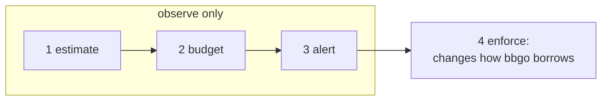
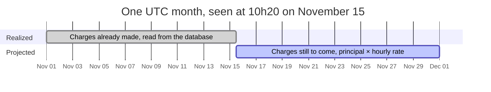
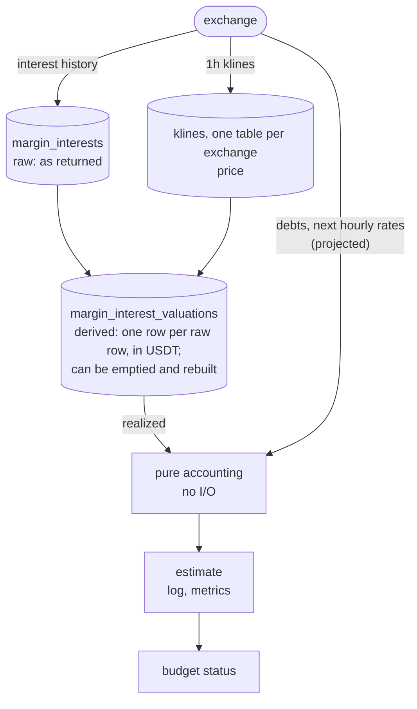

# ADR: Margin Interest Budget

- Status: Step 1 (the estimate) is accepted and implemented: #2742,
  #2743, #2744, #2798, #2745 and #2734 are merged, and #2755 (interest
  paid in another asset) is in review. Step 2 (the budget) is accepted
  and not built yet. Steps 3 and 4 are planned, not designed.
- Scope: `pkg/strategy/autoborrow`, `pkg/accounting/margininterest`,
  `pkg/service`, `pkg/bbgo` (session names), and the
  `margin_interests` and `margin_interest_valuations` tables

## Goal

Know, per margin session and in USDT, how much interest the session
will have paid by the end of the month, and keep that under a budget:
first report it, then alert on it, and eventually stop borrowing
before it is exceeded.

## Context

Nothing in bbgo could answer that question:

- The balance only carries the interest still unpaid, so it forgets
  everything already settled.
- The high-interest-rate alert in autoborrow computes a next-hour
  total, but only over the assets above its rate threshold.
- The margin history sync ran once at startup, stored rows per
  exchange with no session, and had no read method. Two sessions on
  different accounts shared rows, and the second one resumed from the
  first one's newest row, silently skipping its own history.
- `bbgo run` never wrote klines, so a live database had no historical
  prices to value a past charge with.

Two facts about the exchange shape the design:

- **Interest is simple and hourly.** Binance charges principal × the
  hourly rate at the top of each UTC hour, for the hour that starts
  then, plus one prorated charge at the moment of a borrow. Unpaid
  interest is not charged again. The annualized rate the API also
  returns is a compound APY, and is the wrong input for a budget.
- **Debt cannot be attributed to a strategy.** The exchange reports
  one borrowed amount per asset. Autoborrow borrows explicitly, but
  every order with a margin side effect borrows implicitly, and
  repays are fungible. So the smallest unit a budget can honestly
  cover is the session.

One decision about bbgo itself shapes it as well:

- **A session is the account, and the user keeps it that way.** bbgo
  has no account identity: a session is a name, credentials and a
  margin setting, and nothing compares two sessions' credentials.
  This design does not add one. It uses the session name where an
  account id would go, and expects the user to give each margin
  account exactly one session. bbgo does not check it. Two sessions
  on one margin account would each store the same charges and each
  report the whole bill, so adding them up would count it twice.

## Decision

### Four steps, and only the last one acts

The request was too large to build and trust in one change. Each step
ships and is watched in production before the next one starts.

1. **Estimate.** Compute the realized and the projected interest and
   report them.
2. **Budget.** Give each session a monthly budget and report the
   estimate against it.
3. **Alert.** Tell an operator when the budget is exceeded. The
   operator repays or changes strategy settings by hand.
4. **Enforce.** Keep borrowing under the budget, in autoborrow and in
   the other strategies that borrow.

A number that gates borrowing has to be trusted first, so nothing
changes how bbgo borrows until step 4.

### Principles

These came out of the reviews and reshaped the first implementation
more than once.

1. **Hours are the unit; a month only builds a range of hours.** The
   exchange charges by the hour, so the accounting takes an hour count
   or an hour range, never a month.
2. **Raw stays raw.** The raw table stores what the exchange returned,
   in Binance's format, which other exchanges are mapped into. Nothing
   in it is normalized, attributed or priced.
3. **Derived data is rebuildable.** Anything computed from raw rows
   and prices lives in its own table that can be emptied and
   recomputed at any time, so it never needs a backfill migration.
4. **Accounting is pure.** It takes rows, rates and a price function,
   and never touches a database or an exchange, so it can be tested
   with hand-computed numbers.
5. **The autoborrow config is the asset list.** Every configured asset
   is reported, borrowed or not. Anything else is warned about and not
   counted.
6. **An incomplete figure is a lower bound, and says so.** A total that
   is missing a rate, a price or some history is still published, with
   a flag. No consumer may read "incomplete and under budget" as "ok".
7. **USDT is the unit of account, and is named USDT.** Not "USD".

### The estimate: realized plus projected, split at the current hour

Each charge is made at the top of a UTC hour, for the hour that starts
there, so the split falls at the end of the current hour.

- **One split gives both sides,** so every hour of the month is
  counted exactly once. The charge of the current hour has already
  been made: it is realized, never projected.
- **The projection uses the principal, not the debt.** Accrued
  interest earns no interest, so including it would overstate every
  remaining hour.
- **The projection assumes today's principal and rate hold.** It is a
  forecast of "if nothing changes", and it is recomputed from live
  values on every tick.
- **Two month definitions sit on the same hours.** The UTC calendar
  month is realized plus projected, and is what the budget compares,
  because a budget also has to count what was already paid. A rolling
  month is 720 hours from now with no realized part: a run rate, for
  comparing against a monthly figure regardless of the date.

For example, at 10:20 UTC on November 15, 347 of the month's 720 hours
are realized and 373 charges remain. A debt of 10,000 USDT at an
hourly rate of 0.000005 projects 18.65 USDT to the month end, and
36 USDT over a rolling month.

### Where the data lives

- **Raw rows are deduplicated by the exchange's own transaction id.**
  One borrowed asset can have several charges in the same hour (one
  per borrow, plus the hourly one), and two of them can carry the same
  principal. Every key built from columns drops real charges.
- **Raw rows are stored per session.** That is what lets a session's
  sync resume from its own newest row, and what the estimate filters
  by.
- **No backfill.** Rows from before the change stay in the table,
  unread. The next sync fetches the history again under the session
  name, which is simpler and safer than guessing an owner for old
  rows.
- **The valuation is a table, not a column on the raw row,** so a
  price that is not available yet cannot block storing a charge, and
  the valuation rules can change without a migration.
- **The estimate itself is not stored.** The database holds the
  realized inputs, and every tick recomputes the rest.

### Valuing a charge in USDT

- **Price point: the close of the 1h kline that ends when the charge's
  hour begins.** That kline is already closed when the charge is
  published. The kline that contains the charge closes up to an hour
  later.
- **Pair: the asset against USDT, in either direction.** There is no
  route through a third asset until an asset needs one. An asset with
  no such pair stays unpriced, and says so.
- **Both the asset paid and the asset borrowed are valued,** at the
  same kline. They differ only when the interest was paid in another
  asset.
- **The interest sync owns the klines it needs.** A live bbgo does not
  otherwise store klines, so the same pass that syncs interest also
  syncs the price pairs. A missing kline is retried on the next pass.
- **Two price modes for realized interest.** "Charged" (the default)
  is what the interest cost when it was paid. "Current" revalues the
  amounts at today's price. The projection is always at the current
  price.

### Interest paid in another asset

With BNB deduction on, Binance charges the interest in BNB, at a
discount to the nominal amount, and reports those charges under BNB
only, never under the asset that was borrowed.

- **The fee asset is always synced,** configured or not. If that sync
  fails, every asset's history is treated as possibly incomplete.
- **A charge counts toward the asset that was borrowed.** The amount
  reported for that asset is the nominal one, in its own units; what
  was actually paid is kept beside it.
- **USDT comes from what was charged,** so the discount is included.
- **A charge that cannot be attributed is not counted,** and makes the
  estimate incomplete. Guessing would hide it.
- **The projection stays nominal.** On an account that pays in BNB the
  month total errs high by about the discount on the projected part,
  which is the safe side for a budget.

### Where it runs

The estimate runs inside autoborrow, one worker per session, because
autoborrow is the one strategy that needs it and already owns the
asset list. Only the pure accounting is shared. This follows
`doc/development/strategy-layer-design.md`.

The projection is live on every tick. Realized interest lags by the
sync interval, and that lag does not make the estimate incomplete. A
missing rate or price, a failed sync and an unattributed charge do. A
debt or a charge in an asset outside the config is warned about and
does not.

### Session names are identifiers

The session name is now a key in the database, so it has to be a
well-formed, stable identifier, which bbgo does not check today.

- **The rule:** `[a-z0-9_]`, 1 to 64 characters. Lowercase only, so
  two names cannot differ by case alone, which a case-insensitive
  database collation would merge.
- **Where:** at the application level, when the environment loads the
  sessions. A bad name stops bbgo at startup, before any strategy or
  sync has written a row under it.
- **How:** one general validator, not a session-specific check. Any
  config value that is an identifier should go through it. bbgo has no
  identifier type yet; the function comes first and the type can
  follow.

Renaming a session is a change of identity: the rows under the old
name are no longer read, and the history is fetched again under the
new one.

### The budget (step 2, accepted, not built)

The budget is one USDT amount per session and per UTC calendar month,
summed over all configured assets. It is part of the estimate's
config, because it is meaningless without the estimate: a budget with
the estimate off is an error, not a silent no-op.

| Status | Condition | Meaning |
|---|---|---|
| exceeded | realized > budget | already true, and final for the month |
| projected exceeded | month total > budget | a forecast; repaying can still avoid it |
| ok | neither, and the estimate is complete | |
| unknown | neither, and the estimate is incomplete | the true figure may be higher |

- **One budget per session.** A second autoborrow instance that sets a
  budget on the same session is rejected at startup: two budgets on
  one bill cannot both be right, and step 4's caps would conflict.
- **The budget always compares what was charged,** whichever price
  mode the estimate reports in. A budget is about money already spent.
  The projected part is still at the current price, so a price move
  can flip "projected exceeded". That is accepted.
- **Incomplete is never ok.** An incomplete estimate is a lower bound:
  over budget still counts, under budget is "unknown".
- **Landing exactly on the budget is within it.**
- **No budget is not a zero budget.** With none configured, nothing is
  reported at all, so it cannot read as zero or as exceeded.
- **Nothing is persisted.** The month rolls over by itself, because
  the realized range starts at the new UTC month.

Two cases are deliberately left as they are:

- **An estimate that can never be complete,** as on an exchange with
  no rate API. The status is never "ok", and there is no startup
  warning: the status already says it on every tick. Worth revisiting
  once the estimate is used on such an exchange.
- **An asset removed from the config mid-month.** Its earlier charges
  drop out of the month total while the estimate still reads complete;
  only the warning about an unconfigured debt shows it. What to do
  with the debt it leaves behind is a follow-up.

Step 2 only computes the status. Steps 3 and 4 decide what each status
does, including whether "unknown" blocks borrowing.

### Steps 3 and 4 (planned)

- **Step 3** alerts on a status change, with a cooldown while it stays
  exceeded, and takes no action by itself.
- **Step 4** has to choose between blocking new borrows and clamping
  them to the remaining budget, and has to reach the strategies that
  borrow implicitly through orders. The estimate is already computed
  per asset, for a later per-asset budget.

## Follow-ups

- **The identifier validator** described above, and its use on session
  names.
- **Repay when an asset is dropped.** When an asset leaves the
  autoborrow config while it still has debt, bbgo may want to repay
  it, so that it does not keep accruing interest that the budget no
  longer counts.

## Alternatives considered

- **The price on the raw row.** The first implementation priced each
  row at insert time. Dropped: it put a derived value in the raw
  table, needed a backfill for existing rows, and made an insert fail
  whenever the price was not available yet.
- **Deduplicating by columns** (asset, isolated symbol, time, and
  later the borrowed asset). Dropped for the transaction id: charges
  in the same hour collide on any such key.
- **An account id as the row key.** Considered the exchange's own id
  with a session-to-account table, and a bbgo-owned account name on
  the session config. Not taken: the session name is the key, and
  keeping sessions and margin accounts one to one is left to the user.
- **A strategy column.** Rejected: the exchange charges interest on
  the account's principal per asset, so the column would be empty or a
  guess.
- **A SQL view instead of the valuation table.** Rejected: it needs
  the hour arithmetic written per dialect and one kline table per
  exchange.
- **Other price points.** The open of the charge's own hour is
  available up to an hour later than the previous close. A 1m kline
  for prorated charges adds calls for an error that is under an hour
  of price movement on one row.
- **Reusing the profit fixer's price lookup.** It prices at the
  previous day's close, which is too coarse for an hourly charge.
- **Driving the loop from current debts,** with a retention window for
  repaid assets. Replaced by the configured asset list, which also
  closes the gap of a borrow opened and repaid between two syncs.
- **Month-based APIs and a general time-range layer.** Replaced by the
  hour range, with the month as a helper on top.
- **A run rate as "the month".** Kept as the rolling projection, but
  the budget uses the calendar month.
- **Persisting the estimate or the budget state.** Not needed while
  every tick recomputes from the database.
- **Enforcing in the first version.** Deferred to step 4. Repaying
  automatically would also conflict with the existing debt rebalance,
  the high-rate repay and repay-on-deposit.

## Consequences

- Positive: a session's interest for the month is one number with a
  completeness flag, and the same pure functions will back the budget,
  the alert and the cap.
- Positive: margin interest history is now stored per session,
  deduplicated by the exchange's own id, and valued, which makes it
  usable for analysis beyond the budget (the cost of a borrow, the
  fee-asset discount, the effective rate).
- Positive: valuation rules can change without a migration.
- Negative: the estimate needs a configured database, and a live bbgo
  now writes 1h klines for the price pairs.
- Negative: the first sync after the migration fetches the history
  again per session.
- Accepted limits: one session per margin account is the user's to
  keep, and is not checked. Only Binance has a rate API, so elsewhere
  the estimate is never complete. Isolated margin and portfolio margin
  are unverified. A single market's close carries that market's
  spread, and differs slightly from the rate the exchange converted
  at.

## References

- `pkg/accounting/margininterest/` — the pure accounting: hour ranges,
  projection, realized sum.
- `pkg/strategy/autoborrow/interest_estimate.go` — the worker.
- `pkg/service/margin.go`, `pkg/service/margin_valuation.go` — the
  interest sync and the valuation.
- `config/autoborrow.yaml` — the commented config.
- `doc/development/strategy-layer-design.md` — why the worker lives in
  the one strategy that needs it.
