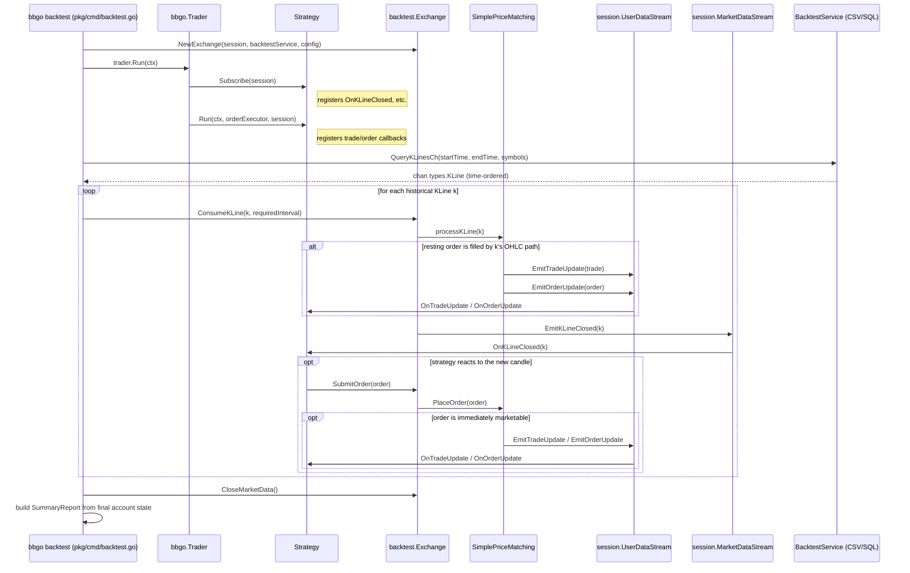
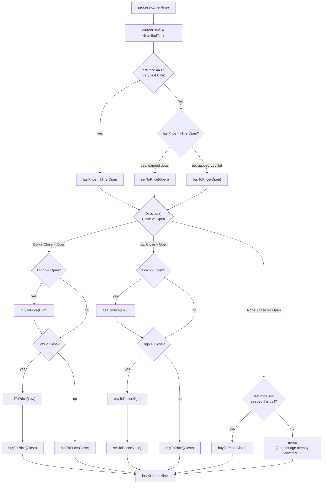
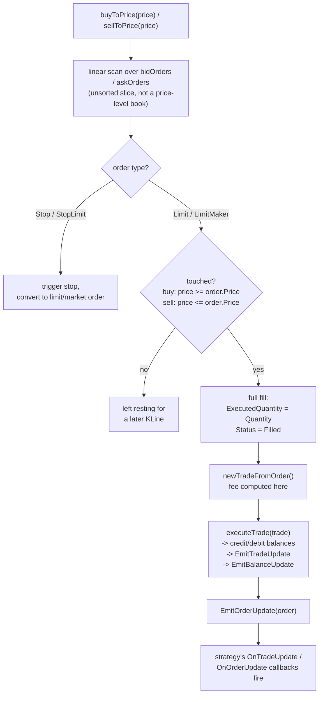

## Back-testing

Currently bbgo supports two ways to run backtests:

  1: Through csv data source (supported right now are binance, bybit and OkEx)

  2: Alternatively run backtests through [MySQL](../../README.md#configure-mysql-database) or [SQLite3
](../../README.md#configure-sqlite3-database). Using MySQL is highly recommended.*

Let's start by adding the back-testing section to your config eg: `bbgo.yaml`:

```yaml
backtest:
  # your back-test will start at the 2021-01-10, be sure to sync the data before 2021-01-10 
  # because some indicator like EMA needs more data to calculate the current EMA value.
  startTime: "2021-01-10"

  # your back-test will end at the 2021-01-10
  endTime: "2021-01-21"
  
  # the symbol data that you want to sync and back-test
  symbols:
  - BTCUSDT

  sessions:
  - binance
  
  # feeMode is optional
  # valid values are: quote, native, token
  #   quote: always deduct fee from the quote balance
  #   native: the crypto exchange fee deduction, base fee for buy order, quote fee for sell order.
  #   token: count fee as crypto exchange fee token
  # feeMode: quote
  
  accounts:
    # the initial account balance you want to start with
    binance: # exchange name
      balances:
        BTC: 0.0
        USDT: 10000.0
```

Note on date formats, the following date formats are supported:
* RFC3339, which looks like `2006-01-02T15:04:05Z07:00`
* RFC822, which looks like `02 Jan 06 15:04 MST`
* You can also use `2021-11-26T15:04:56`

And then, you can sync remote exchange k-lines (candle bars) data for back-testing through csv data source:
```sh
bbgo backtest -v --csv --verify --config config/grid.yaml
```
or use the sql data source like so:
```sh
bbgo backtest -v --sync --config config/grid.yaml
```

To customize the sync data range, add `--sync-from`:

```sh
bbgo backtest -v --sync --sync-only --sync-from 2020-11-01 --config config/grid.yaml
```

Note that, you should sync from an earlier date before your startTime because some indicator like EMA needs more data to calculate the current EMA value.
Here we sync one month before `2021-01-10`.

- `--sync` - sync the data to the latest data point before we start the back-test.
- `--sync-only` - only the back-test data syncing will be executed. do not run back-test.
- `--sync-from` - sync the data from a specific endpoint. note that, once you've start the sync, you can not simply add more data before the initial date.
- `-v` - verbose message output
- `--config config/grid.yaml` - use a specific config file instead of the default config file `./bbgo.yaml`

Run back-test:

```sh
bbgo backtest --base-asset-baseline --config config/grid.yaml
```
or through csv data source

```sh
bbgo backtest -v --csv --base-asset-baseline --config config/grid.yaml --output data/backtest
```

If you're developing a strategy, you might want to start with a command like this:

```shell
godotenv -f .env.local -- go run ./cmd/bbgo backtest --config config/grid.yaml --base-asset-baseline
```

## How the backtest engine replays history

The backtest engine does not give strategies a special "backtest mode" API. Instead, it
swaps `session.Exchange` for a `*backtest.Exchange` (`pkg/backtest/exchange.go`) that
replays historical k-lines through the exact same `types.StandardStream` / order
callback plumbing used in live trading, so a strategy's `Subscribe`, `Run`,
`OnKLineClosed` and order-update handlers run unmodified.

At a high level, for every closed k-line pulled from the historical data source:

1. `backtest.Exchange.ConsumeKLine` first lets the simulated matching engine fill any
   resting orders by walking the OHLC path of that k-line, emitting trade/order updates
   on the session's `UserDataStream` (the same stream `core.TradeCollector` and order
   executors listen to).
2. It then emits `OnKLineClosed` on the `MarketDataStream`, which is what actually wakes
   the strategy up.
3. Any order the strategy submits in response goes through `backtest.Exchange.SubmitOrder`
   into the matching engine, to be filled against a later k-line.

Everything happens synchronously, one k-line at a time, in a single goroutine — that's
what makes a backtest run deterministic and lets it reuse live-trading strategy code
as-is.



## How the matching engine processes a single KLine

Inside `backtest.Exchange.ConsumeKLine`, the actual order matching for one closed
k-line is done by `SimplePriceMatching.processKLine` (`pkg/backtest/matching.go`). It
only ever looks at `Open`/`High`/`Low`/`Close` — there is no volume-based fill cap, so
any resting order whose price falls inside the OHLC range fills in full (no partial
fills). It works by walking price from the previous close to this candle's `Open`,
then along the OHLC path implied by the candle's direction, calling `buyToPrice(price)`
or `sellToPrice(price)` at each leg to touch resting orders on the way:



Each `buyToPrice`/`sellToPrice` call is where resting orders actually get touched and
filled — `buyToPrice` tests resting **asks** (price rising can hit a sell), `sellToPrice`
tests resting **bids** (price falling can hit a buy). Stop/stop-limit orders are
triggered and converted first; touched limit orders fill completely and emit events in
`trade → balance → order` order:



An order submitted mid-kline via `SubmitOrder` takes a separate, immediate path in
`PlaceOrder`: if it's marketable against `lastPrice` (a market order, or a limit order
crossing the current price) it fills right away as a taker trade; otherwise it's simply
appended to `bidOrders`/`askOrders` and waits to be picked up by a future
`buyToPrice`/`sellToPrice` walk as described above.

## See Also

* [apps/backtest-report](../../apps/backtest-report) - BBGO's built-in backtest report viewer

* [MDD](https://www.investopedia.com/terms/m/maximum-drawdown-mdd.asp) - If you want to test the max draw down (MDD) you can adjust the start date to somewhere near 2020-03-12.
